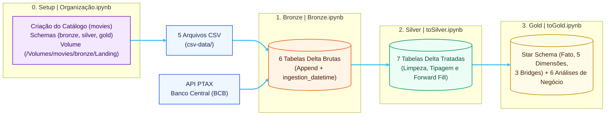
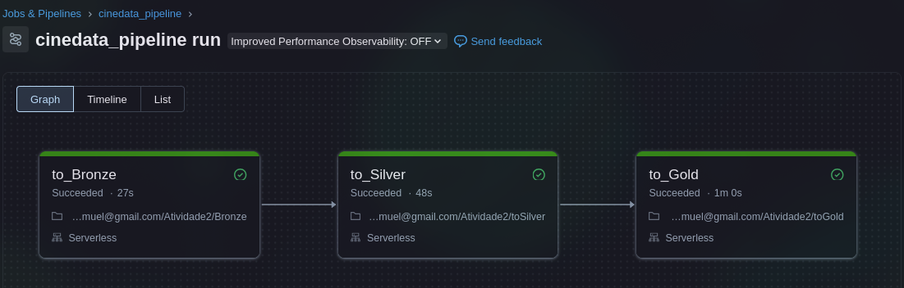
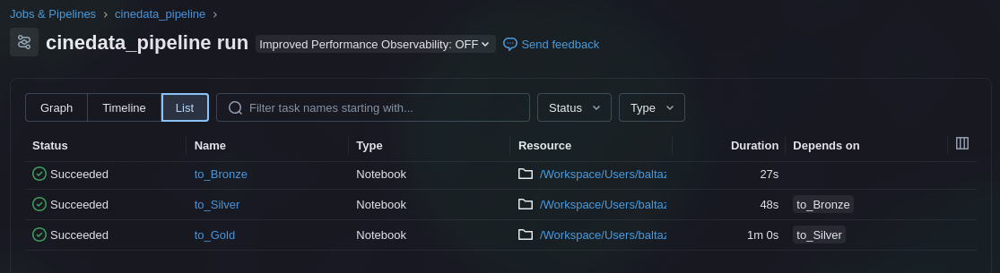

# CineData Analytics — Pipeline de Dados End-to-End no Databricks

Pipeline completo de Engenharia de Dados construído no **Databricks** utilizando **PySpark**, **Spark SQL**, **Delta Lake** e **Unity Catalog**. O projeto transforma bases brutas e fragmentadas de filmes (TMDB/IMDb) enriquecidas com cotações históricas do dólar (API PTAX do Banco Central do Brasil) em um Data Warehouse analítico modelado em **Star Schema**, seguindo a **Arquitetura Medalhão (Bronze, Silver e Gold)**.

---

## Sumário

1. [Visão Geral e Arquitetura](#1-visão-geral-e-arquitetura)
2. [Estrutura do Repositório](#2-estrutura-do-repositório)
3. [Detalhamento das Etapas e Notebooks](#3-detalhamento-das-etapas-e-notebooks)
   - [0. Organização e Bootstrap do Ambiente (`Organização.ipynb`)](#0-organização-e-bootstrap-do-ambiente-organizaçãoipynb)
   - [1. Camada Bronze (`Bronze.ipynb`)](#1-camada-bronze-bronzeipynb)
   - [2. Camada Silver (`toSilver.ipynb`)](#2-camada-silver-tosilveripynb)
   - [3. Camada Gold e Analytics (`toGold.ipynb`)](#3-camada-gold-e-analytics-togoldipynb)
4. [Modelagem Dimensional (Star Schema)](#4-modelagem-dimensional-star-schema)
5. [Orquestração e Databricks Workflow](#5-orquestração-e-databricks-workflow)
6. [Como Executar o Projeto](#6-como-executar-o-projeto)

---

## 1. Visão Geral e Arquitetura

O objetivo do projeto é estruturar dados de inteligência de mercado do setor audiovisual que chegam originalmente com ruídos, deslocamento de colunas (*Column Shift*), múltiplos formatos de data, separadores inconsistentes e valores monetários sem padronização.



---

## 2. Estrutura do Repositório

```text
cinedata/
├── csv-data/                                  # inputs do pipeline
│   ├── credits_and_tags_IMDB_TMDB.csv         
│   ├── movies_financials_IMDB_TMDB.csv        
│   ├── movies_info_TMDB_IMDB.csv              
│   ├── movies_metrics_IMDB_TMDB.csv           
│   └── movies_reviews.csv                     
├── notebooks/
│   ├── Organização.ipynb                      # [Passo 0] Criação de catálogo, schemas, volume e validação dos CSVs
│   ├── Bronze.ipynb                           
│   ├── toSilver.ipynb                         
│   └── toGold.ipynb                           
├── screenshots/
│   ├── graph.png                              # Screenshot do DAG executado com sucesso no Databricks Workflows
│   └── list.png                               # Detalhamento das tarefas e tempos de execução do Job
├── job.yaml                                   # Definição declarativa exportada do Databricks Workflow
└── README.md                                  # Documentação do projeto
```

---

## 3. Detalhamento das Etapas e Notebooks

### 0. Organização do Ambiente (`Organização.ipynb`)

Este notebook é o **ponto de partida obrigatório** antes da primeira execução do pipeline. Ele prepara a infraestrutura do Data Lakehouse no Unity Catalog:

1. **Definição de Parâmetros:** Configura o catálogo `movies`, os schemas `bronze`, `silver` e `gold`, e a rota do volume `/Volumes/movies/bronze/Landing`.
2. **Provisionamento de Objetos:**
   - Cria o catálogo `movies`.
   - Cria os schemas `bronze`, `silver` e `gold`.
   - Cria o Volume gerenciado `Landing` dentro de `movies.bronze`.
3. **Validação da Camada Landing:** Após o upload dos 5 arquivos CSV para o Volume, a etapa final do notebook inspeciona `/Volumes/movies/bronze/Landing` via `dbutils.fs.ls`, confirmando se todos os arquivos esperados estão presentes e listando seus respectivos tamanhos em KB.

---

### 1. Camada Bronze (`Bronze.ipynb`)

Responsável pela ingestão fiel dos dados brutos para tabelas Delta usando o modo `append` e adicionando o metadado de auditoria `ingestion_datetime` (`current_timestamp()`).

#### Ingestão de Arquivos CSV
Lê os 5 arquivos do Volume `/Volumes/movies/bronze/Landing` sem alteração estrutural (`inferSchema=false`, `multiLine=true`):

| Arquivo de Origem (Volume) | Tabela Destino (Bronze) |
|---|---|
| `movies_info_TMDB_IMDB.csv` | `bronze.tb_movies_info` |
| `movies_financials_IMDB_TMDB.csv` | `bronze.tb_movies_financials` |
| `movies_metrics_IMDB_TMDB.csv` | `bronze.tb_movies_metrics` |
| `credits_and_tags_IMDB_TMDB.csv` | `bronze.tb_credits_and_tags` |
| `movies_reviews.csv` | `bronze.tb_movies_reviews` |

#### Ingestão da API do Banco Central (PTAX)
Consulta o endpoint oficial OData do Banco Central do Brasil para obter a cotação de compra do dólar (`cotacaoCompra` e `dataHoraCotacao`) e persiste os dados na tabela `bronze.tb_cotacao_dolar`.
- Utiliza **Databricks Widgets** para parametrizar o intervalo de datas no formato `MM-DD-AAAA` (com fallback automático para os últimos 7 dias corridos caso executado sem parâmetros externos).

---

### 2. Camada Silver (`toSilver.ipynb`)

Transforma os dados brutos da camada Bronze em 7 tabelas higienizadas, deduplicadas, com colunas padronizadas em português e tipagem estrita:

| Tabela Silver | Origem Bronze | Principais Regras de Negócio Aplicadas |
|---|---|---|
| `silver.tb_cotacao_dolar` | `tb_cotacao_dolar` | Criação de série temporal contínua entre a menor e a maior data e aplicação de **Forward Fill** para preencher finais de semana e feriados com a cotação do último dia útil disponível. |
| `silver.tb_info_filmes` | `tb_movies_info` | Normalização e tradução de `status_filme` (*Lançado*, *Pós-Produção*, *Em Produção*, *Planejado*, *Rumores*, *Cancelado* ou *Não Informado*); parsing multi-formato de `data_lancamento` (`try_to_date` com 6 padrões); extração de `ano_lancamento`; deduplicação por `id_filme` mantendo a ingestão mais recente. |
| `silver.tb_financeiro_filmes` | `tb_movies_financials` | Remoção de símbolos monetários (`$`, `R$`, vírgulas) e textos de ausência (`Unknown`, `Não Informado`); invalidação de valores `<= 0` para `NULL`; conversão para Reais (`orcamento_brl`, `receita_brl`) usando a cotação mais recente; cálculo de `lucro_usd`, `lucro_brl` e `margem_lucro_pct` (protegido contra divisão por zero). |
| `silver.tb_metricas_engajamento` | `tb_movies_metrics` | Padronização de separador decimal em `popularidade`; uso de `try_cast` para contornar deslocamento de colunas (*Column Shift*); validação de domínio (notas entre `0` e `10`, contagens de votos e popularidade `>= 0`). |
| `silver.tb_avaliacoes_usuarios` | `tb_movies_reviews` | Remoção de avaliações integralmente duplicadas; validação de `nota_usuario` na escala de `0` a `10`; preenchimento de comentários nulos ou em branco com `"Sem comentário"`. |
| `silver.tb_generos` | `tb_credits_and_tags` | Padronização de separadores (`;` para `,`), desmembramento com `split` + `explode`, limpeza de valores numéricos deslocados, formatação `initcap` e deduplicação. |
| `silver.tb_pessoas_empresas` | `tb_credits_and_tags` | Unificação das colunas `cast`, `directors`, `writers` e `production_companies` categorizadas por `tipo_entidade` (`Ator`, `Diretor`, `Roteirista`, `Produtora`), com limpeza de ruídos e `initcap`. |

---

### 3. Camada Gold e Analytics (`toGold.ipynb`)

Consolida os dados da camada Silver em uma modelagem dimensional **Star Schema** voltada para Business Intelligence e executa as 6 consultas analíticas de validação:

1. **Receita Total em Reais (BRL):** Soma global de `receita_brl` na tabela fato.
2. **Top 5 Filmes por Popularidade:** Ranking dos 5 títulos de maior índice de popularidade.
3. **Volume de Filmes por Gênero:** Contagem distinta de filmes por gênero cinematográfico em ordem decrescente.
4. **Top 10 Filmes por Receita:** Listagem com título, receita em USD, receita em BRL e posição no ranking utilizando a Window Function `RANK()`.
5. **Ator com Maior Participação (Últimos 2 Anos):** Identifica o ator com mais filmes lançados nos últimos 24 meses a partir da data de lançamento realizada mais recente da base.
6. **Produtora com Maior Lucro (Últimos 5 Anos):** Identifica o estúdio/produtora com o maior lucro acumulado nos últimos 60 meses a partir da data de lançamento realizada mais recente da base.

---

## 4. Modelagem Dimensional (Star Schema)

Todas as tabelas da camada Gold utilizam chaves substitutas (*Surrogate Keys* `BIGINT`) geradas via `monotonically_increasing_id()`. Para resolver relacionamentos muitos-para-muitos ($N:N$) entre filmes e gêneros, pessoas e produtoras sem duplicar o grão da tabela fato, foram implementadas 3 **Bridge Tables** (tabelas-ponte):

- **Tabela Fato:**
  - `gold.fact_movies_performance` (`sk_movie_id`, `orcamento_usd`, `receita_usd`, `lucro_usd`, `orcamento_brl`, `receita_brl`, `lucro_brl`, `popularidade`, `nota_media_tmdb`, `qtd_votos_tmdb`, `nota_media_imdb`, `qtd_votos_imdb`)
- **Tabelas Dimensão:**
  - `gold.dim_movies` (`sk_movie_id`, `id_filme`, `titulo`, `data_lancamento`, `ano_lancamento`, `duracao_minutos`, `idioma_original`, `status_filme`, `sinopse`)
  - `gold.dim_genres` (`sk_genre_id`, `nome_genero`)
  - `gold.dim_people` (`sk_person_id`, `nome_pessoa`, `tipo_pessoa`)
  - `gold.dim_companies` (`sk_company_id`, `nome_produtora`)
  - `gold.dim_reviews` (`sk_review_id`, `sk_movie_id`, `qtd_avaliacoes_usuarios`, `nota_media_usuarios`)
- **Tabelas-Ponte (Bridges):**
  - `gold.bridge_movie_genre` (`sk_movie_id`, `sk_genre_id`)
  - `gold.bridge_movie_person` (`sk_movie_id`, `sk_person_id`)
  - `gold.bridge_movie_company` (`sk_movie_id`, `sk_company_id`)

---

## 5. Orquestração e Databricks Workflow

O pipeline é orquestrado pelo Databricks Workflows (definido em [`job.yaml`](job.yaml)) sob o nome `cinedata_pipeline`, executando em compute **Serverless** com agendamento diário (`28 0 3 * * ?` — `America/Sao_Paulo`):

| Task Key | Notebook Associado | Dependência (`depends_on`) |
|---|---|---|
| `to_Bronze` | `notebooks/Bronze.ipynb` | *Nenhuma (raiz do DAG)* |
| `to_Silver` | `notebooks/toSilver.ipynb` | `to_Bronze` |
| `to_Gold` | `notebooks/toGold.ipynb` | `to_Silver` |

### Evidências de Execução

**Grafo de Dependências (DAG) executado com sucesso:**


**Detalhamento das Tarefas e Duração:**


---

## 6. Como Executar o Projeto

### Pré-requisitos
- Conta em um Workspace **Databricks** com **Unity Catalog** habilitado.
- Compute com suporte a PySpark / Delta Lake (ou compute **Serverless**).
- Acesso de saída à internet pelo cluster para consultar a API pública do Banco Central.

### Passo a Passo

#### Passo 1: Importar o Repositório no Databricks
1. No menu lateral do Databricks, acesse **Workspace** (ou **Repos**).
2. Clone este repositório GitHub ou importe os notebooks da pasta `notebooks/`.

#### Passo 2: Executar o Bootstrap de Ambiente (`Organização.ipynb`)
1. Abra o notebook [`notebooks/Organização.ipynb`](notebooks/Organização.ipynb) e conecte-o a um cluster ou Serverless.
2. Execute a **Parte 1** e a **Parte 2** do notebook para criar automaticamente:
   - O catálogo `movies`
   - Os schemas `bronze`, `silver` e `gold`
   - O Volume `/Volumes/movies/bronze/Landing`

#### Passo 3: Fazer Upload dos Arquivos CSV e Validar
1. No menu lateral do Databricks, abra **Catalog** e navegue até `movies` > `bronze` > **Volumes** > `Landing`.
2. Clique em **Upload to this volume** e envie os 5 arquivos da pasta local [`csv-data/`](csv-data/):
   - `credits_and_tags_IMDB_TMDB.csv`
   - `movies_financials_IMDB_TMDB.csv`
   - `movies_info_TMDB_IMDB.csv`
   - `movies_metrics_IMDB_TMDB.csv`
   - `movies_reviews.csv`
3. Volte ao notebook [`notebooks/Organização.ipynb`](notebooks/Organização.ipynb) e execute a **Parte 4 (Validação)** para confirmar a mensagem `"Todos os arquivos estão presentes"`.

#### Passo 4: Executar o Pipeline Medalhão
Você pode rodar o pipeline de duas maneiras:

- **Execução Interativa (Manual):**
  1. Execute [`notebooks/Bronze.ipynb`](notebooks/Bronze.ipynb)
  2. Execute [`notebooks/toSilver.ipynb`](notebooks/toSilver.ipynb) para processar e higienizar todas as tabelas da camada Silver.
  3. Execute [`notebooks/toGold.ipynb`](notebooks/toGold.ipynb) para construir as tabelas do Star Schema e visualizar os resultados das 6 perguntas de negócio gerados via `display()`.

- **Execução Orquestrada (Databricks Workflows):**
  1. Em **Workflows > Jobs**, crie um Job ou importe a configuração de [`job.yaml`](job.yaml) ajustando o `notebook_path` para o caminho do seu usuário no Workspace.
  2. Clique em **Run now** para disparar a cadeia `to_Bronze -> to_Silver -> to_Gold`.
